<p align="center">
  
</p>

<p align="center">
  <a href="https://github.com/Bryanstolfi">
    
  </a>
</p>

<p align="center">
  <a href="https://instagram.com/bryanvstolfi"></a>
  <a href="mailto:kotimdev@gmail.com"></a>
  
  <a href="https://app.richpulse.com.br"></a>
  
</p>

---

## 👋 Sobre mim

```ts
const kotim = {
  nome: "Bryan Stolfi",
  apelido: "Kotim",
  local: "Blumenau, SC 🇧🇷",
  faz: ["SaaS", "ERPs", "Painéis admin", "Apps mobile e desktop", "Integrações de pagamento"],
  agora: "Construindo o RichPulse, app de alertas de mercado",
  ferramentas: ["VS Code", "Claude"],
  curiosidade: "Já criei e mantive servidores de GTA RP (FiveM)",
};
```

## 🧰 Stacks

<h4>🖥️ Front-end</h4>
<p>
  
  
  
  
  
  
  
  
</p>

<h4>⚙️ Back-end e dados</h4>
<p>
  
  
  
  
  
  
</p>

<h4>📱 Apps</h4>
<p>
  
  
  
  
</p>

<h4>☁️ Deploy e infra</h4>
<p>
  
  
  
  
</p>

<h4>🎨 Design e ferramentas</h4>
<p>
  
  
  
</p>

## 🚀 Projetos

<table>
  <tr>
    <td width="50%" valign="top">
      <h3>📈 <a href="https://app.richpulse.com.br">RichPulse</a></h3>
      <p>App de alertas de mercado para ações da B3, FIIs, cripto e dólar. Carteira, radar de memecoins, resumos com IA e bot no Telegram.</p>
      <p><code>Next.js</code> <code>Supabase</code> <code>Vercel</code> <code>Electron</code> <code>Capacitor</code></p>
    </td>
    <td width="50%" valign="top">
      <h3>🧠 Kotify</h3>
      <p>Plataforma de inteligência comercial: laboratório de ofertas, copiloto de preços e lead scoring.</p>
      <p><code>Next.js</code> <code>Supabase</code> <code>TypeScript</code></p>
    </td>
  </tr>
  <tr>
    <td width="50%" valign="top">
      <h3>📚 Studium IA</h3>
      <p>Plataforma de estudos com painel admin e quiz ao vivo no estilo Kahoot.</p>
      <p><code>Next.js</code> <code>Supabase</code> <code>Realtime</code></p>
    </td>
    <td width="50%" valign="top">
      <h3>💬 DevCard</h3>
      <p>Extensão do VS Code que mostra no Discord o que você está programando.</p>
      <p><code>TypeScript</code> <code>VS Code API</code> <code>Discord RPC</code></p>
    </td>
  </tr>
</table>

> 🔒 A maioria dos repositórios é privada (projetos de clientes). Quer ver algo? Me chama.

## 📊 Estatísticas

<p align="center">
  
  
</p>

<p align="center">
  
</p>

<p align="center">
  
</p>

<p align="center">
  
</p>

## 🐍 Comendo minhas contribuições

<p align="center">
  <picture>
    <source media="(prefers-color-scheme: dark)" srcset="https://raw.githubusercontent.com/Bryanstolfi/Bryanstolfi/output/snake-dark.svg">
    
  </picture>
</p>

<p align="center">
  
</p>
